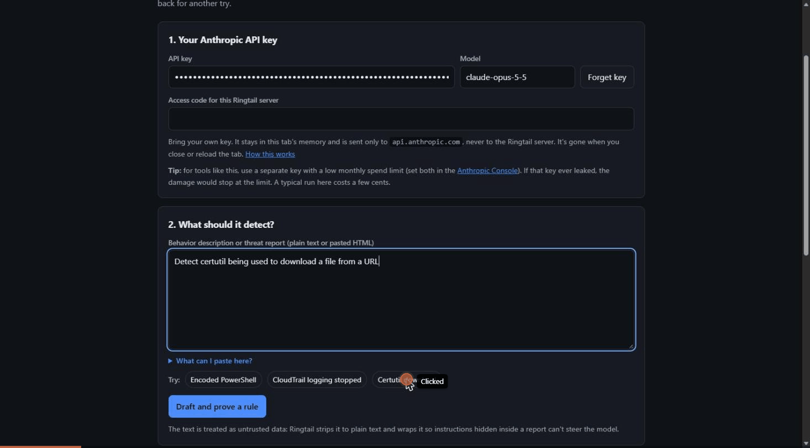
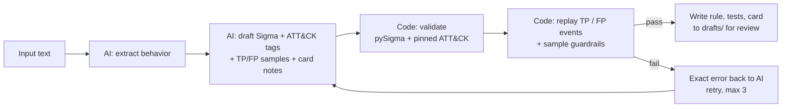
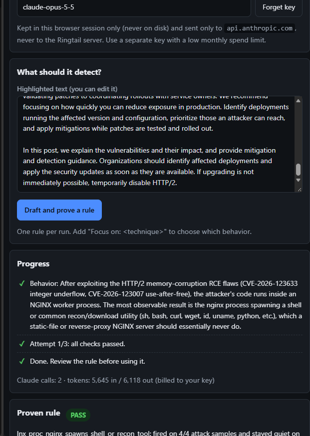
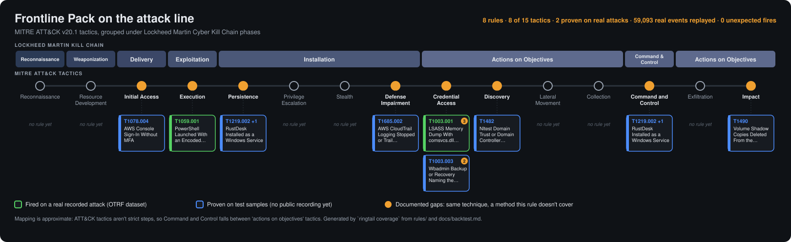

# Ringtail

[](https://github.com/kjohnsonthecoder/ringtail/actions/workflows/test.yml)

**Plain English in, rules that must fire out.**

Ringtail turns a plain-English behavior description or a threat report into a
[Sigma](https://sigmahq.io) detection rule, maps it to MITRE ATT&CK, and **proves** the rule
works by replaying sample logs: it must fire on the attack and stay quiet on benign activity.

**Try it: <https://web-production-34d65045.up.railway.app>** (bring your own Anthropic
API key; it stays in your browser tab and goes only to Anthropic).



> Status: v0.4. CLI, BYOK web page, and the **Highlight to Detect** browser extension
> ([web/](web/README.md), [backend/](backend/README.md), [extension/](extension/README.md)).
> Every rule converts to Splunk SPL and Microsoft KQL, and is backtested against real
> recorded attacks and cross-checked by a second Sigma engine.

## Pipeline



AI output is untrusted. Code decides. See the [threat model](docs/threat-model.md) for how
Ringtail handles prompt injection, your API key, and model output.

## Quickstart

Requires Python 3.11 to 3.13 (pySigma doesn't support 3.15 yet). On Windows, clone to a
short path (for example `C:\src\ringtail`): the Anthropic SDK has long file names that can
hit Windows' 260-character path limit in deep folders.

```bash
git clone https://github.com/kjohnsonthecoder/ringtail.git
cd ringtail
python -m venv .venv
. .venv/bin/activate        # Windows: .venv\Scripts\activate
pip install -e ".[dev]"
ringtail validate rules/    # pySigma lint + ATT&CK IDs against pinned v20.1
ringtail test rules/        # replay true-positive / false-positive samples
pytest
```

Those need no API key. To draft new rules with AI, bring your own key (BYOK). Ringtail
reads it from the environment and never stores, logs, or proxies it:

```bash
export ANTHROPIC_API_KEY=...          # PowerShell: $env:ANTHROPIC_API_KEY = "..."
ringtail run "detect encoded powershell"
ringtail run --file report.txt        # a pasted threat report (text or HTML)
ringtail draft "detect encoded powershell"   # just print an unverified draft
```

`ringtail run` loops up to 3 times. It drafts the rule plus true-positive and
false-positive samples and card notes, then validates and tests them. Failures go back to
the model as exact errors. A passing draft lands in `drafts/` (git-ignored) as
`drafts/rules/<slug>.yml`, `drafts/tests/rules/<slug>/`, and `drafts/cards/<slug>.md`.
Review it, then move it into `rules/frontline-pack/` on purpose.

| Command | Does | Exit codes |
|---|---|---|
| `ringtail validate <rules>` | pySigma parse + lint, required metadata, ATT&CK v20.1 IDs | 0 pass, 1 fail |
| `ringtail test <rules>` | Replay TP/FP samples | 0 pass, 1 fail |
| `ringtail card <rules> [--check]` | Generate detection cards, or check they're fresh | 0 pass, 1 fail/stale |
| `ringtail convert <rules> [-t splunk\|kql]` | Splunk SPL and Microsoft Sentinel / Defender KQL queries | 0 ok, 1 not convertible |
| `ringtail backtest [--check]` | Replay pinned real attack recordings (OTRF) against every rule | 0 pass, 1 regression/unexpected/stale |
| `ringtail crosscheck` | Compare verdicts with RSigma, an independent Sigma engine | 0 agree, 1 disagree |
| `ringtail coverage [--check]` | Draw the rules on the ATT&CK tactic line (SVG) | 0 pass, 1 stale |
| `ringtail draft "<text>"` | AI draft only, prints YAML | 0 ok, 1 model error |
| `ringtail run "<text>"` | Full loop, writes to `drafts/` | 0 pass, 1 fail |

Exit code 2 means a usage or config problem, such as a missing `ANTHROPIC_API_KEY`.
The default model is `claude-opus-5-5`; set `RINGTAIL_MODEL` to change it.

## Web page (local)

The same loop in a browser. Your key stays in the tab and goes only to Anthropic; the
Ringtail server builds prompts and runs the checks, and never sees it
([ADR 0003](docs/decisions/0003-browser-byok-architecture.md)).

```bash
pip install -e ".[web]"
uvicorn backend.app:app       # open http://127.0.0.1:8000
```

## Browser extension: Highlight to Detect

Highlight attacker behavior in any threat report, right-click **Detect with Ringtail**, and
the side panel drafts and proves a rule, with Splunk and KQL queries. It can't read the
pages you visit: it only gets the text you highlight and choose to send. Your key stays in
browser session memory and goes only to Anthropic
([ADR 0005](docs/decisions/0005-browser-extension.md), [install](extension/README.md)).



## Frontline Pack

Eight rules covering an intrusion from first discovery to ransomware, plus two cloud
account-takeover signals. Several come from the behaviors in a public BumbleBee-to-Akira
ransomware intrusion report.



**Proven twice, beyond the samples** ([ADR 0006](docs/decisions/0006-real-data-backtest-and-second-engine.md)):

- **Real recorded attacks.** CI replays 13 pinned [OTRF](https://github.com/OTRF/Security-Datasets)
  recordings (59,093 events) against every rule. The LSASS and encoded-PowerShell rules fire on
  the real attacks, nothing fires where it shouldn't, and same-technique methods a rule doesn't
  cover are listed as gaps, not hidden. Full results: [docs/backtest.md](docs/backtest.md).
- **A second engine.** CI runs every rule through [RSigma](https://github.com/timescale/rsigma),
  an independent Sigma engine, on the same samples and recordings, and fails on any
  disagreement with Ringtail's matcher.

| Rule | ATT&CK | Tests | Card |
|---|---|---|---|
| [PowerShell launched with an encoded command](rules/frontline-pack/windows/win_proc_encoded_powershell.yml) | T1059.001 | 4 TP / 3 FP | [card](cards/win_proc_encoded_powershell.md) |
| [Nltest domain trust or DC discovery](rules/frontline-pack/windows/win_proc_nltest_domain_trust_discovery.yml) | T1482 | 3 TP / 3 FP | [card](cards/win_proc_nltest_domain_trust_discovery.md) |
| [RustDesk installed as a Windows service](rules/frontline-pack/windows/win_system_rustdesk_service_install.yml) | T1219.002, T1543.003 | 2 TP / 2 FP | [card](cards/win_system_rustdesk_service_install.md) |
| [LSASS memory dump with comsvcs.dll MiniDump](rules/frontline-pack/windows/win_proc_lsass_dump_comsvcs.yml) | T1003.001 | 3 TP / 3 FP | [card](cards/win_proc_lsass_dump_comsvcs.md) |
| [Wbadmin backup or recovery naming NTDS](rules/frontline-pack/windows/win_proc_wbadmin_ntds_backup.yml) | T1003.003 | 3 TP / 3 FP | [card](cards/win_proc_wbadmin_ntds_backup.md) |
| [Volume shadow copies deleted](rules/frontline-pack/windows/win_proc_shadow_copy_deletion.yml) | T1490 | 4 TP / 4 FP | [card](cards/win_proc_shadow_copy_deletion.md) |
| [AWS console sign-in without MFA](rules/frontline-pack/cloudtrail/aws_console_login_without_mfa.yml) | T1078.004 | 2 TP / 3 FP | [card](cards/aws_console_login_without_mfa.md) |
| [AWS CloudTrail logging stopped or trail deleted](rules/frontline-pack/cloudtrail/aws_cloudtrail_logging_disabled.yml) | T1685.002 | 3 TP / 4 FP | [card](cards/aws_cloudtrail_logging_disabled.md) |

Each card covers the goal, ATT&CK mapping, log source, logic in plain English, ready-to-paste
Splunk and KQL queries, known false positives, triage steps (including the rule's coverage
gaps), and live test results. Cards are generated (`ringtail card rules/`) and CI fails if
one is stale.

Each rule `rules/**/<rule-id>.yml` is tested by `tests/rules/<rule-id>/true_positive.json`
(every event must match) and `false_positive.json` (no event may match).

## Security

- [Threat model](docs/threat-model.md): prompt injection, BYOK, untrusted AI output

## Design decisions

- [ADR 0001: Test engine](docs/decisions/0001-test-engine.md)
- [ADR 0002: Pinned ATT&CK index](docs/decisions/0002-pinned-attack-index.md)
- [ADR 0003: Browser BYOK architecture](docs/decisions/0003-browser-byok-architecture.md)
- [ADR 0004: SIEM query conversion](docs/decisions/0004-siem-conversion.md)
- [ADR 0005: Browser extension](docs/decisions/0005-browser-extension.md)
- [ADR 0006: Real-data backtest and a second engine](docs/decisions/0006-real-data-backtest-and-second-engine.md)

## License

MIT
