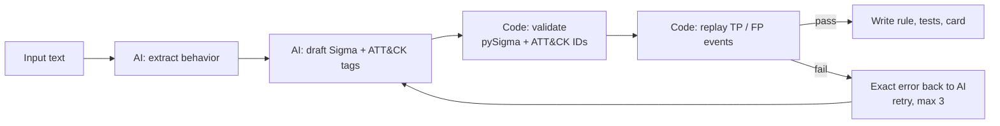

# Ringtail

[](https://github.com/kjohnsonthecoder/ringtail/actions/workflows/test.yml)

**Plain English in, rules that must fire out.**

Ringtail turns a plain-English behavior description or a threat report into a
[Sigma](https://sigmahq.io) detection rule, maps it to MITRE ATT&CK, and **proves** the rule
works by replaying sample logs: it must fire on the attack and stay quiet on benign activity.

> Status: v0.1 in progress. `validate`, `test`, and `card` work today, and both Frontline
> Pack rules pass. The AI steps (`draft`, `run`) are next.

## Pipeline



AI output is untrusted. Code decides.

## Quickstart

Requires Python 3.11 to 3.13 (pySigma doesn't support 3.15 yet).

```bash
git clone https://github.com/kjohnsonthecoder/ringtail.git
cd ringtail
python -m venv .venv
. .venv/bin/activate        # Windows: .venv\Scripts\activate
pip install -e ".[dev]"
ringtail validate rules/    # pySigma lint + ATT&CK IDs against pinned v20.1
ringtail test rules/        # replay true-positive / false-positive samples
pytest
```

## Frontline Pack

| Rule | ATT&CK | Tests | Card |
|---|---|---|---|
| [PowerShell launched with an encoded command](rules/frontline-pack/windows/win_proc_encoded_powershell.yml) | T1059.001 | 4 TP / 3 FP | [card](cards/win_proc_encoded_powershell.md) |
| [AWS CloudTrail logging stopped or trail deleted](rules/frontline-pack/cloudtrail/aws_cloudtrail_logging_disabled.yml) | T1685.002 | 3 TP / 4 FP | [card](cards/aws_cloudtrail_logging_disabled.md) |

Each card covers the goal, ATT&CK mapping, log source, logic in plain English, known false
positives, triage steps, and live test results. Cards are generated (`ringtail card rules/`)
and CI fails if one is stale.

Each rule `rules/**/<rule-id>.yml` is tested by `tests/rules/<rule-id>/true_positive.json`
(every event must match) and `false_positive.json` (no event may match).

## Design decisions

- [ADR 0001: Test engine](docs/decisions/0001-test-engine.md)
- [ADR 0002: Pinned ATT&CK index](docs/decisions/0002-pinned-attack-index.md)

## License

MIT
