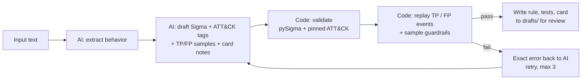

# Ringtail

[](https://github.com/kjohnsonthecoder/ringtail/actions/workflows/test.yml)

**Plain English in, rules that must fire out.**

Ringtail turns a plain-English behavior description or a threat report into a
[Sigma](https://sigmahq.io) detection rule, maps it to MITRE ATT&CK, and **proves** the rule
works by replaying sample logs: it must fire on the attack and stay quiet on benign activity.

**Try it: <https://web-production-34d65045.up.railway.app>** (bring your own Anthropic
API key; it stays in your browser tab and goes only to Anthropic).

> Status: v0.1 done (CLI, Frontline Pack, CI). v0.2 done: the BYOK web page and its
> stateless backend ([web/](web/README.md), [backend/](backend/README.md)), hosted on Railway.

## Pipeline



AI output is untrusted. Code decides. See the [threat model](docs/threat-model.md) for how
Ringtail handles prompt injection, your API key, and model output.

## Quickstart

Requires Python 3.11 to 3.13 (pySigma doesn't support 3.15 yet). On Windows, clone to a
short path (for example `C:\src\ringtail`): the Anthropic SDK has long file names that can
hit Windows' 260-character path limit in deep folders.

```bash
git clone https://github.com/kjohnsonthecoder/ringtail.git
cd ringtail
python -m venv .venv
. .venv/bin/activate        # Windows: .venv\Scripts\activate
pip install -e ".[dev]"
ringtail validate rules/    # pySigma lint + ATT&CK IDs against pinned v20.1
ringtail test rules/        # replay true-positive / false-positive samples
pytest
```

Those need no API key. To draft new rules with AI, bring your own key (BYOK). Ringtail
reads it from the environment and never stores, logs, or proxies it:

```bash
export ANTHROPIC_API_KEY=...          # PowerShell: $env:ANTHROPIC_API_KEY = "..."
ringtail run "detect encoded powershell"
ringtail run --file report.txt        # a pasted threat report (text or HTML)
ringtail draft "detect encoded powershell"   # just print an unverified draft
```

`ringtail run` loops up to 3 times. It drafts the rule plus true-positive and
false-positive samples and card notes, then validates and tests them. Failures go back to
the model as exact errors. A passing draft lands in `drafts/` (git-ignored) as
`drafts/rules/<slug>.yml`, `drafts/tests/rules/<slug>/`, and `drafts/cards/<slug>.md`.
Review it, then move it into `rules/frontline-pack/` on purpose.

| Command | Does | Exit codes |
|---|---|---|
| `ringtail validate <rules>` | pySigma parse + lint, required metadata, ATT&CK v20.1 IDs | 0 pass, 1 fail |
| `ringtail test <rules>` | Replay TP/FP samples | 0 pass, 1 fail |
| `ringtail card <rules> [--check]` | Generate detection cards, or check they're fresh | 0 pass, 1 fail/stale |
| `ringtail draft "<text>"` | AI draft only, prints YAML | 0 ok, 1 model error |
| `ringtail run "<text>"` | Full loop, writes to `drafts/` | 0 pass, 1 fail |

Exit code 2 means a usage or config problem, such as a missing `ANTHROPIC_API_KEY`.
The default model is `claude-opus-5-5`; set `RINGTAIL_MODEL` to change it.

## Web page (local)

The same loop in a browser. Your key stays in the tab and goes only to Anthropic; the
Ringtail server builds prompts and runs the checks, and never sees it
([ADR 0003](docs/decisions/0003-browser-byok-architecture.md)).

```bash
pip install -e ".[web]"
uvicorn backend.app:app       # open http://127.0.0.1:8000
```

## Frontline Pack

| Rule | ATT&CK | Tests | Card |
|---|---|---|---|
| [PowerShell launched with an encoded command](rules/frontline-pack/windows/win_proc_encoded_powershell.yml) | T1059.001 | 4 TP / 3 FP | [card](cards/win_proc_encoded_powershell.md) |
| [AWS CloudTrail logging stopped or trail deleted](rules/frontline-pack/cloudtrail/aws_cloudtrail_logging_disabled.yml) | T1685.002 | 3 TP / 4 FP | [card](cards/aws_cloudtrail_logging_disabled.md) |

Each card covers the goal, ATT&CK mapping, log source, logic in plain English, known false
positives, triage steps, and live test results. Cards are generated (`ringtail card rules/`)
and CI fails if one is stale.

Each rule `rules/**/<rule-id>.yml` is tested by `tests/rules/<rule-id>/true_positive.json`
(every event must match) and `false_positive.json` (no event may match).

## Security

- [Threat model](docs/threat-model.md): prompt injection, BYOK, untrusted AI output

## Design decisions

- [ADR 0001: Test engine](docs/decisions/0001-test-engine.md)
- [ADR 0002: Pinned ATT&CK index](docs/decisions/0002-pinned-attack-index.md)
- [ADR 0003: Browser BYOK architecture](docs/decisions/0003-browser-byok-architecture.md)

## License

MIT
