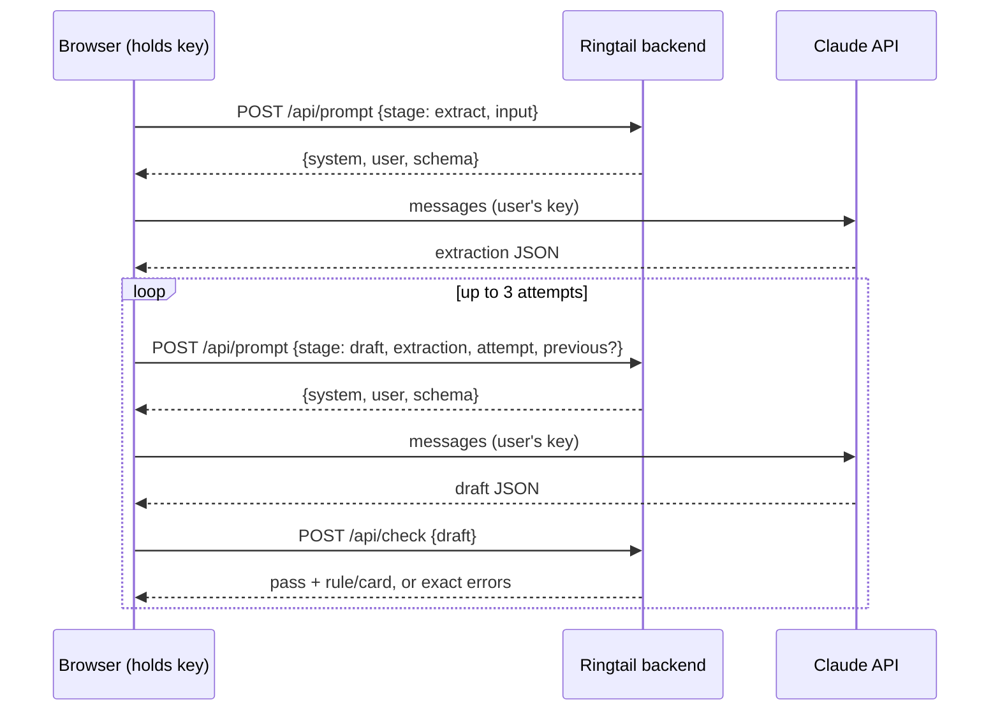

# backend/: Ringtail web backend (v0.2)

A stateless FastAPI checker. **It never calls Claude and never accepts an API key.** The
browser holds the user's key and calls Claude directly; this server builds the prompts and
runs the same deterministic checks as `ringtail run` and CI.
See [ADR 0003](../docs/decisions/0003-browser-byok-architecture.md).



## Run locally

```bash
pip install -e ".[web]"
uvicorn backend.app:app --reload     # http://127.0.0.1:8000/api/health
```

## Endpoints

| Method | Path | Body | Returns |
|---|---|---|---|
| GET | `/api/health` | | `{status, attack_version, default_model, max_attempts}` |
| POST | `/api/prompt` | `{"stage": "extract", "input": "<text>"}` | `{stage, purpose, system, user, schema}` |
| POST | `/api/prompt` | `{"stage": "draft", "extraction": {...}, "attempt": 1}` | same |
| POST | `/api/prompt` | `{"stage": "draft", "extraction": {...}, "attempt": 2, "previous": {failed draft}}` | same; errors recomputed server-side |
| POST | `/api/check` | `{"draft": {...}}` | `{passed, errors}` plus `result` (rule YAML, samples, card) when it passes |

Errors are `{"error": "<message>"}` with 400 (bad request), 411/413 (body size), or 429
(rate limit, with `Retry-After`).

## Settings (environment)

| Variable | Default | |
|---|---|---|
| `RINGTAIL_RATE_PER_MINUTE` | 30 | POSTs per client IP per minute |
| `RINGTAIL_MAX_BODY_BYTES` | 262144 | |
| `RINGTAIL_WEB_DIR` | `web/` | Static page served at `/` if it has an `index.html` |

The logic lives in `core/ringtail/service.py`; this module is only the HTTP layer
(limits, key refusal, security headers). Threats and controls: `docs/threat-model.md`, T6.
