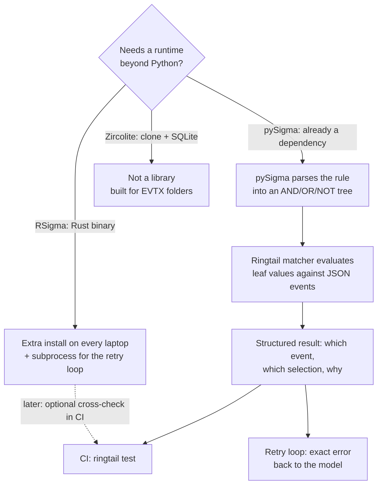

# ADR 0001: Test engine for replaying sample events against Sigma rules

- **Status:** Accepted
- **Date:** 2026-11-17
- **Decider:** Kevin Johnson

## Context

Ringtail's core promise is that a rule is only "done" when deterministic code proves it:
it must match every true-positive sample event and none of the false-positive ones. We need
an engine that evaluates a Sigma rule against small JSON events. It has to work in three
places:

1. **CI (GitHub Actions):** `ringtail test` runs over every committed rule on each push or PR.
2. **The `ringtail run` retry loop:** when a test fails, the exact reason goes back to the
   LLM, so the result has to be readable as structured data in Python, not just a pass/fail
   exit code.
3. **A contributor's laptop (Windows, macOS, Linux):** a fresh clone needs to work with
   only Python and `pip install`.

The brief lists three candidates.

## Options compared

| | **RSigma** (Rust) | **Zircolite** (Python) | **pySigma matcher** (ours) |
|---|---|---|---|
| What it is | Rust Sigma toolkit: parser, eval engine, linter, CLI. `rsigma rule backtest` replays corpora against per-rule expectations | Python tool that loads events into in-memory SQLite and runs Sigma rules converted to SQL | A small evaluator that walks the condition tree pySigma already parses |
| Install | Rust binary (cargo or release download), or the `timescale/rsigma-action` in CI | Not a pip package: clone the repo + `requirements.txt` (EVTX parsing via `pyevtx-rs`) | Nothing new. pySigma is already a required dependency |
| Runs in GitHub Actions | Yes, with a published Action | Yes, after cloning and installing it | Yes, plain `pip install` |
| Runs on a fresh laptop | Needs a Rust toolchain or a platform binary next to Python | Needs a second checkout and its deps | Yes |
| Callable from Python in-process | No, subprocess + parse JSON/JUnit output | Awkward: it's a CLI script, not a library | Yes, returns Python objects |
| Explains *why* a rule fired or didn't | Yes (built in) | Partial (shows the SQL) | We build it: report which selection matched or failed |
| Sigma coverage | Broad, maintained by a dedicated project | Broad, via pySigma's SQLite backend | Only what we implement. **We own the semantics** |
| Fit for tiny JSON fixtures | Good | Built for EVTX and log folders, heavy for a few events | Built for exactly this |

## Decision

**Build a minimal pySigma-based matcher** (`core/ringtail/matcher.py`) and drive it from
`core/ringtail/testrunner.py`.

### Why

- **Smallest footprint:** pySigma is already required for validation, so the test engine
  adds no dependency. `pip install -e .` is the whole setup in CI and on a laptop.
- **pySigma does the hard part:** it parses the condition (`all of selection_*`,
  `1 of x*`, `not filter`), applies modifiers (`contains`, `endswith`, `windash`,
  `base64offset`, `re`, `all`), and gives us a resolved expression tree with typed
  values. Our matcher only evaluates the leaves: about 200 lines.
- **The retry loop needs in-process, structured failures.** "Event 2 in
  `true_positive.json` did not match: `CommandLine` failed `selection_enc`" is the kind of
  error we want to send back to the model. That's straightforward when the matcher is our
  own Python.

### Consequences and guardrails

- **We own matching semantics, which is the main risk.** A rule could pass in Ringtail but
  behave differently in a real SIEM. Mitigations:
  - **Fail loud, never silently pass:** any value type or feature the matcher doesn't
    implement (CIDR, field references, numeric comparisons, correlation rules, placeholders)
    raises `UnsupportedSigmaFeature` and the test is reported as an **error**, not a pass.
  - Follow the Sigma spec where it's explicit: string matching is case-insensitive unless
    `|cased`; a list value in an event matches if any element matches; keywords (no field)
    search every string value in the event.
  - The matcher has its own pytest suite in `tests/` that checks each supported modifier.
- **Revisit when** the Frontline Pack grows past a handful of rules, or we import large
  public datasets (OTRF, EVTX-ATTACK-SAMPLES). The likely move is to add RSigma's GitHub
  Action as a **second, independent check** in CI, so two engines have to agree. This
  doesn't change the local developer setup.
- **Python version:** pySigma 2.x depends on `google-re2` and PyYAML's C loader, neither of
  which ships for Python 3.15 yet (found on 2026-11-17). Ringtail targets
  **Python 3.11–3.13**, and CI runs on 3.12.

## References

- RSigma backtesting in a GitHub Action: <https://itnext.io/detection-as-code-in-one-github-action-with-rsigma-0ebfb4c857fa>
- Zircolite: <https://github.com/wagga40/Zircolite>
- pySigma: <https://github.com/SigmaHQ/pySigma>
- Sigma specification (modifiers, case sensitivity): <https://github.com/SigmaHQ/sigma-specification>
