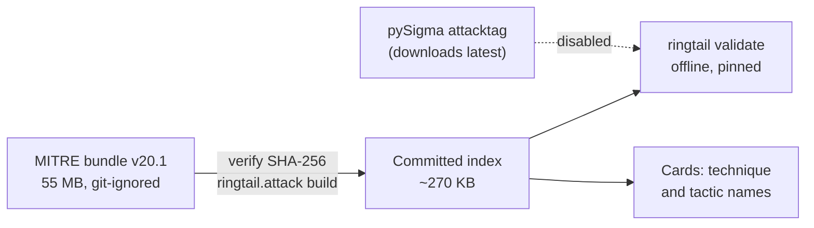

# ADR 0002: Pin ATT&CK as a small committed index, not the full bundle

- **Status:** Accepted
- **Date:** 2026-11-17
- **Decider:** Kevin Johnson

## Context

`ringtail validate` must reject unknown, revoked, or deprecated ATT&CK IDs against a
**pinned** ATT&CK version (CLAUDE.md). Two facts shaped how:

- The Enterprise ATT&CK v20.1 STIX bundle is **55 MB**. Committing it bloats every clone,
  and GitHub warns on files over 50 MB.
- pySigma's built-in `attacktag` validator downloads the *latest* ATT&CK from GitHub at
  runtime. That isn't pinned, and it needs the network in CI.

## Decision

Commit a deterministic **derived index** (`data/attack/enterprise-attack-20.1.index.json`,
~270 KB) and turn off pySigma's network validators. The index records the source URL and
the bundle's SHA-256, and `python -m ringtail.attack build` regenerates it byte for byte.

## Consequences

- Validation is offline and reproducible; CI needs no network or API key.
- Error messages can name the replacement for a revoked ID ("T1562.008 is revoked; use
  T1685.002"), which is exactly what the AI retry loop needs.
- Upgrading ATT&CK is a deliberate commit that shows up in review.
- We trust our own index builder. It has unit tests against a synthetic bundle, and the
  source hash lets anyone check it against MITRE's file.

## First catch

ATT&CK v20 split Defense Evasion into **Stealth (TA0005)** and **Defense Impairment
(TA0112)**, and revoked T1562 / T1562.008. The CloudTrail rule, written to the original
brief's T1562.008, failed validation and now maps to **T1685.002 Disable or Modify Cloud
Log**.
