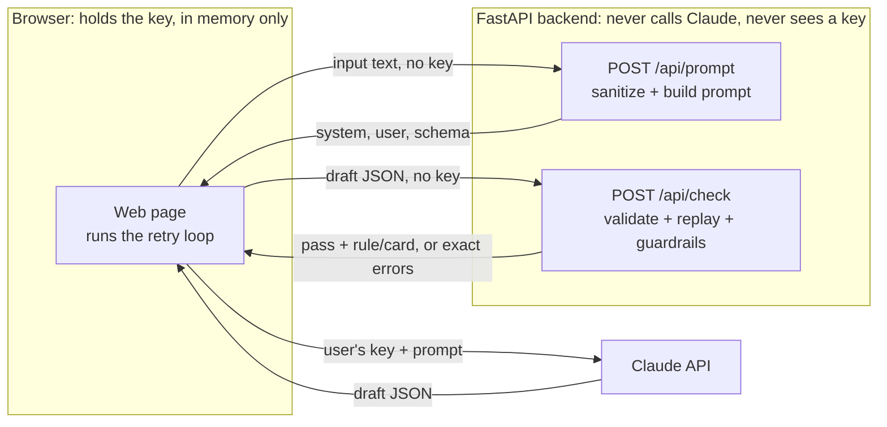

# ADR 0003: Browser BYOK architecture for the web page

- Status: accepted
- Date: 2026-11-18
- Applies to: v0.2 (web page + FastAPI backend)

## Context

v0.1 is a CLI. The key lives in the user's environment, and the whole loop (extract, draft,
validate, test, retry) runs on the user's machine.

v0.2 adds a web page. CLAUDE.md fixes two constraints:

1. **BYOK.** Ringtail never ships, stores, or proxies a key. The page calls Claude
   directly from the user's browser, and **the backend never sees a key**.
2. **AI output is untrusted. Code decides.** The checks that make a draft "done" (pySigma
   lint, pinned ATT&CK, TP/FP replay, sample guardrails) must be the same code as the CLI's,
   not a JavaScript re-implementation that can drift.

Those pull in different directions. The key can only be in the browser, but the checks are
Python (pySigma has no JavaScript equivalent).

## Options

| Option | Key exposure | Checks | Verdict |
|---|---|---|---|
| A. Backend proxies Claude calls | Key crosses our server on every request | Python, server-side | Violates BYOK. Rejected. |
| B. Everything in the browser (Pyodide/WASM) | Browser only | Python in WASM, ~30 MB download, google-re2 has no wheel | Too heavy, fragile. Rejected for now. |
| C. Browser calls Claude; backend is a stateless checker | Browser only | Same Python as the CLI, on the server | **Chosen.** |

## Decision

Split by what each side is allowed to hold.

- **The browser owns the loop.** It asks the backend for a prompt, sends that prompt to
  Claude with the user's key, posts Claude's reply to `/api/check`, and on failure asks for a
  retry prompt that carries the exact errors. Max 3 attempts, same as the CLI.
- **The backend owns the prompts and the checks.** `/api/prompt` runs the same
  `sanitize.to_plain_text` + `wrap_as_data` + templates as `ringtail run`. `/api/check` runs
  the same `pipeline.check_draft`. One source of truth, shared with the CLI and CI.
- **The backend is stateless.** No database, no sessions, no stored drafts. Every request
  carries everything it needs. Nothing about the user is kept.
- **The backend never calls Claude**, so it has no reason to accept a key. Requests that
  carry an `Authorization`, `x-api-key`, or similar header are rejected outright, so a
  misconfigured client fails loudly instead of quietly sending a key to our server.

### What the browser cannot be trusted with, and why that's fine

The browser could skip `/api/check` and show an unchecked draft. That only fools the user
running it. A rule is only trusted when it is committed to the repo and passes CI, which
runs the same checks again. The web page is a drafting tool, not an authority.

### Shared code

`core/ringtail/service.py` exposes the two operations as plain functions that take and
return JSON-able dicts. The FastAPI app (`backend/app.py`) is a thin HTTP layer over them,
so they're unit-tested without HTTP and reusable by any other front end (the v0.3 browser
extension will talk to the same endpoints).

## Consequences

- The API is public and unauthenticated, so it needs request-size caps and a per-IP rate
  limit. `/api/check` runs pySigma and the matcher, which are CPU-bound but bounded by the
  size caps. See `docs/threat-model.md`.
- Calling Anthropic straight from a browser requires the
  `anthropic-dangerous-direct-browser-access: true` header. The name is a warning about
  exposing a key in shipped front-end code. Here the key is typed by its owner and kept in
  page memory, which is the use case the header exists for. The threat model covers the
  remaining risk: any script on the page can read the key, so the page loads no
  third-party scripts and sets a strict Content Security Policy.
- Model output is rendered in the page. It must be inserted as text, never as HTML.
- The prompt templates are served to anyone. That's fine: they are already public in
  this repo.
- If pySigma gains a maintained WASM build, option B becomes possible and removes the
  backend entirely. Revisit then.
