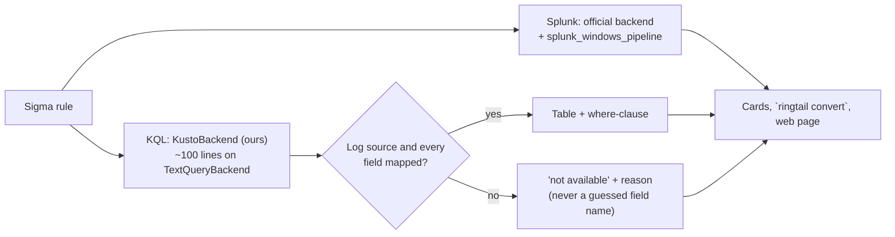

# ADR 0004: SIEM query conversion (Splunk SPL and KQL)

- Status: accepted
- Date: 2026-11-18

## Context

A Sigma rule is portable, but an analyst deploys a query. Showing each rule as Splunk SPL
and Microsoft KQL (Sentinel and Defender XDR) makes the Frontline Pack usable as-is and
shows the same detection across the two SIEMs most SOC teams run.

pySigma has backends for both. What we found when we tried them against pySigma 2.1.0,
which the matcher and validator are built on (ADR 0001):

| Backend | Latest | Works with pySigma 2.x? |
|---|---|---|
| `pysigma-backend-splunk` | 3.0.1 | **Yes.** Converts all Frontline Pack rules. |
| `pysigma-backend-kusto` | 0.4.5 | **No.** Crashes on import (`SigmaTransformationError` moved in pySigma 2). |
| `pysigma-backend-kusto` | 1.0.1 | **No.** Requires pySigma below 2, so installing it downgrades pySigma to 1.5.1. |

## Options for KQL

1. Downgrade pySigma to 1.x. Rejected: it would break the matcher and validator, and
   would pin the project to an old release.
2. Patch the Kusto backend at import time. Rejected: a monkeypatch of a third-party
   package breaks silently on its next release.
3. **Write a small KQL backend on pySigma's own `TextQueryBackend`**, the base class the
   official backends use, with explicit table and field mappings. **Chosen.**

## Decision

- `core/ringtail/convert.py` holds both. `convert_rule(text)` returns one result per target:
  a query plus the schema it assumes, or an error explaining what isn't mapped.
- **KQL mappings are explicit and short**: Windows and Linux process creation go to
  Defender `DeviceProcessEvents` (added for Linux in v0.3, after the first extension run
  produced a Linux rule), the Windows System log to Sentinel's `Event` table, and
  CloudTrail to Sentinel's `AWSCloudTrail` table. A rule using an unmapped log source or
  field gets "not available" with the reason. A query with a wrong field name returns
  nothing in the SIEM, which looks exactly like "no attacks", so a guessed mapping is
  worse than no query.
- **KQL details handled on purpose**:
  - `=~`, `in~` and `contains` for case-insensitive matching, as Sigma intends.
  - `==` for numbers, because `=~` is a string operator.
  - `not(...)`, because `not` is a function in KQL.
  - Every compound expression is grouped, so readers don't need to know precedence rules.
  - Duplicate OR branches are dropped when two Sigma fields map to one column.
- **Splunk**: the official backend with its Windows pipeline (System log becomes
  `source="WinEventLog:System"`, `EventID` becomes `EventCode`). CloudTrail queries get
  `sourcetype="aws:cloudtrail"`.
- Queries appear in every detection card, in `ringtail convert`, and on the web page.
  Cards put each query in a code fence longer than any backtick run in it, so a value in an
  AI-drafted rule can't break out of the fence.

## Consequences

- `pysigma-backend-splunk` is pinned to `3.0.x`. Cards embed its output and CI fails on a
  stale card, so an upgrade is a deliberate commit that regenerates the cards.
- CI checks that every committed rule converts to both targets.
- **Not verified against a live SIEM.** Tests check the structure of each query (tables,
  mapped columns, operators, escaping), not that it runs in a real workspace. Field names
  also vary with how logs are collected. The cards and page say to check them against
  your own data, and a first deployment into a SIEM is a human step.
- Revisit when a pySigma-2-compatible Kusto backend is released: swapping it in would
  bring Microsoft's maintained field mappings for many more log sources.
