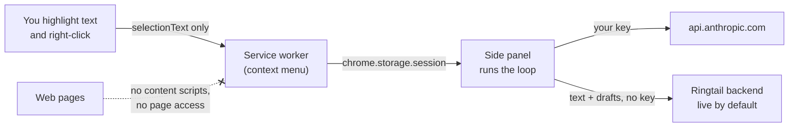

# ADR 0005: Browser extension "Highlight to Detect"

- Status: accepted
- Date: 2026-11-18
- Applies to: v0.3

## Context

Analysts read threat reports in the browser. The extension lets them highlight the part
that describes attacker behavior, right-click, and get a proven rule without copying and
pasting into another tab.

A browser extension is a powerful thing to install: badly designed, it can read every page
you visit. The design goal is the opposite: the smallest permissions that do the job, the
same BYOK guarantees as the web page (ADR 0003), and the same checks as the CLI.

## Decision

### Permissions: as few as possible

| Permission | Why |
|---|---|
| `contextMenus` | The "Detect with Ringtail" item on a text selection. The click hands over the selected text, so no page access is needed. |
| `sidePanel` | The panel where the loop runs and results appear. |
| `storage` | `chrome.storage.session` for the key and the pending selection (see below). |
| Host `https://api.anthropic.com/*` | Calls Claude with the user's key. |
| Host: the live Ringtail backend | Builds prompts and runs checks. |
| Optional host `https://*/*`, `http://localhost/*` | Requested at runtime, for one origin only, if the user points the extension at a self-hosted backend. Never granted at install. |

Deliberately **not** used: content scripts, `scripting`, `tabs`, `activeTab`, `<all_urls>`,
`web_accessible_resources`, `externally_connectable`. Websites have no channel to the
extension at all, and the extension never sees page content beyond what the user
selects and sends.

### Key storage: `chrome.storage.session`

The key survives closing and reopening the panel, so an analyst can work through a report.
It's held in memory, is wiped when the browser quits, is never written to disk, and is
readable only by the extension's own pages (Chrome's default access level for session
storage excludes content scripts, and there are none anyway). It is never put in
`storage.local` or `storage.sync`, which persist to disk and sync across devices. A
"Forget key" button clears it immediately.

### Backend: live by default, configurable

The panel uses the live Railway backend so the extension works out of the box. A settings
field lets a self-hoster enter their own URL, and the extension requests host permission
for that one origin at that moment. The access code (if the server is locked) is stored
in session storage like the key, and is sent only to the Ringtail backend, never to
Anthropic.

### One loop, shared with the web page

The draft → check → retry loop and the result rendering move out of `web/app.js` into two
ES modules, `web/ringtail-client.js` (logic, no DOM) and `web/ringtail-ui.js` (rendering).
The web page and the side panel both import them. Manifest V3 forbids loading remote
code, so the extension ships its own copies in `extension/lib/`; a pytest check fails if
they drift from `web/`. The logic module is unit-tested with Node's built-in test runner
(`node --test`, no npm packages).

### Distribution

A zip on each GitHub release ("load unpacked") and the Chrome Web Store. The store needs
a privacy policy, per-permission justifications, icons, and screenshots, all kept in the
repo. Kevin owns the developer account and submits. Supported browsers: Chrome and Edge,
which both run Manifest V3 side panels.

## Consequences

- No backend changes are needed: extension pages with host permission make
  cross-origin requests without CORS, and the backend's rate limit, access code, and key
  refusal apply unchanged.
- Calls to Anthropic still send `anthropic-dangerous-direct-browser-access: true`. As on
  the web page, the key is typed by its owner, not embedded in shipped code.
- Store review checks that permissions match the stated purpose. Keeping the list short
  is also what makes review straightforward.
- Updates through the store are signed and reviewed by Google; "load unpacked" users
  update by hand from the GitHub release.
- The shared modules change how the web page is organized; its behavior must not change
  (checked in the browser after the refactor).
