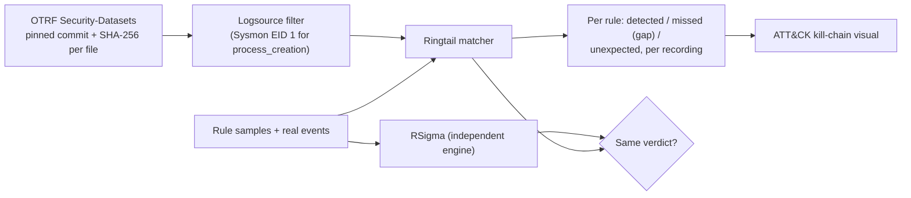

# ADR 0006: Real-data backtest and a second Sigma engine

- Status: accepted
- Date: 2026-11-18

## Context

Every Frontline Pack rule is proven against samples written by the same hand as the rule
(threat model T2: "they agree but are both wrong"). And every verdict comes from one engine,
Ringtail's own matcher (ADR 0001), which supports a subset of Sigma. Two questions follow:

1. Does each rule fire on **real recorded attacks**, and stay quiet on real recordings of
   other techniques?
2. Would an **independent Sigma engine** reach the same verdicts?

## Decision

### Real-data backtest (`ringtail backtest`)

- **Data:** [OTRF Security-Datasets](https://github.com/OTRF/Security-Datasets) (MIT), lab
  recordings of known techniques. `data/datasets/otrf.yml` pins the repository commit, and
  each file's SHA-256, and lists the ATT&CK techniques **verified to be present** in each
  recording (not just its file name).
- **Matching:** each rule only sees events of its own log source (process creation = Sysmon
  event 1), using the same matcher as the rule tests.
- **Outcome per rule and recording:**
  - *detected*: the recording contains the rule's technique and the rule fired;
  - *missed*: it contains the technique but the rule stayed quiet. This is a **coverage gap**,
    reported, not hidden (for example, LSASS dumped with Task Manager instead of comsvcs);
  - *unexpected*: the rule fired on a recording without its technique. This needs review.
- **Report:** `data/datasets/backtest.json` and `docs/backtest.md`, generated and committed.
  CI re-downloads the pinned files, re-runs the backtest, and fails if the result changes, the
  same pattern as detection cards.
- **Untrusted input:** downloaded archives are verified by SHA-256 before use, read in memory
  (never extracted to disk), limited to `.json` members, and capped in size.

### Second engine (`ringtail crosscheck`)

- [RSigma](https://github.com/timescale/rsigma) (Rust, MIT/Apache) evaluates every rule
  against its own test samples and against the real recorded events, and CI fails on any
  disagreement with Ringtail's matcher.
- CI downloads a pinned release (v0.27.0) and checks its SHA-256 before running it. It runs
  only in CI's throwaway machine; locally the cross-check is skipped unless RSigma is
  installed.

### The visual (`ringtail coverage`)

An SVG of the Frontline Pack on the ATT&CK tactic line, with Lockheed Martin Cyber Kill
Chain phases above it, each rule colored by its evidence: proven on real attack data, or
proven on test samples only, with recorded gaps marked. It's generated from the rules and the
backtest report, and CI fails if it's stale.

ATT&CK and the Kill Chain are related but not the same model. The Kill Chain (2011) is seven
ordered phases; ATT&CK's tactics are attacker goals that don't have to happen in order, each
with many observed techniques. The visual maps each tactic to its closest Kill Chain phase,
and the mapping doesn't line up perfectly (Command and Control sits between "actions on
objectives" tactics in ATT&CK's order), which is shown rather than smoothed over.

## Consequences

- A rule can be honestly labeled "samples only" when no public recording exists (nltest,
  RustDesk, shadow copy deletion, and both CloudTrail rules today).
- OTRF is a lab dataset with low background noise. "No unexpected fires" is evidence, not a
  false-positive rate for a production network.
- New CI dependencies: the OTRF files (about 4.4 MB, cached) and the RSigma binary.
