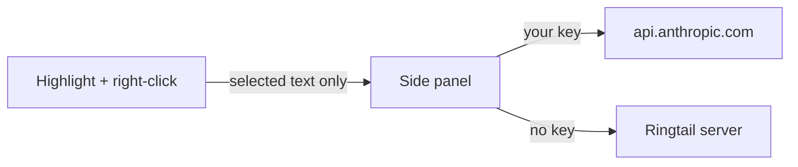

# extension/: Ringtail "Highlight to Detect" (v0.3)

Highlight attacker behavior in a threat report on any site, right-click, choose
**Detect with Ringtail**, and get a Sigma rule proven against sample logs, with Splunk and
KQL queries, in Chrome's side panel. Bring your own Anthropic API key.

Design and reasoning: [ADR 0005](../docs/decisions/0005-browser-extension.md) ·
threats and controls: [threat model T7](../docs/threat-model.md).



## Install (load unpacked)

1. Download `ringtail-extension-<version>.zip` from the GitHub release and unzip it, or use
   this `extension/` folder from a clone.
2. Open `chrome://extensions` (Edge: `edge://extensions`) and turn on **Developer mode**.
3. Click **Load unpacked** and pick the folder that contains `manifest.json`.
4. Pin Ringtail from the puzzle-piece menu if you like. Clicking it opens the side panel.

Requires Chrome or Edge 116 or newer.

## Permissions, and why

| Permission | Why |
|---|---|
| `contextMenus` | The "Detect with Ringtail" item when text is selected. The click hands over only the selected text. |
| `sidePanel` | Where the loop runs and results appear. |
| `storage` | Your key and access code in session storage (memory only, cleared when the browser quits). Server URL and model name in local storage. |
| `api.anthropic.com` | Calls Claude with your key. |
| The Ringtail server | Builds prompts and runs the checks. Never receives your key. |
| Optional: one server address you choose | Only if you point the extension at a self-hosted server, requested at that moment. |

No content scripts, no `tabs`, `activeTab`, `scripting`, or `<all_urls>`: the extension
can't read the pages you visit.

## Development

The loop and rendering are shared with the web page. `web/` is the source of truth:

```bash
python scripts/sync_extension.py      # copy web/ringtail-*.js and style.css into lib/
python scripts/make_icons.py          # regenerate icons/
node --test tests/js/client.test.mjs  # unit tests for the shared loop
pytest tests/test_extension.py        # manifest rules + lib/ copies in sync
```

After editing, click the reload icon on the extension's card in `chrome://extensions`.
