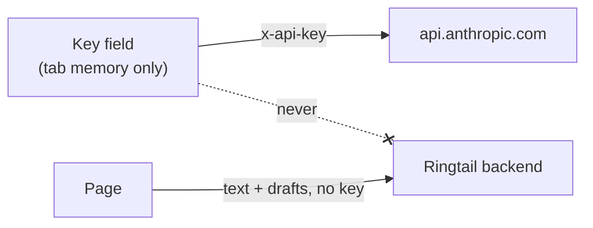

# web/: the Ringtail web page (v0.2)

Plain HTML, CSS, and JavaScript. No framework, no build step, no third-party scripts.
The backend serves it from `/` (same origin), see [backend/README.md](../backend/README.md).

```bash
pip install -e ".[web]"
uvicorn backend.app:app       # then open http://127.0.0.1:8000
```

## How it handles your key (BYOK)



- The key sits in a password field. It isn't saved to `localStorage`, cookies, or anywhere
  else, so it's gone on reload. "Forget key" clears it immediately.
- It's sent only to `https://api.anthropic.com/v1/messages`, with the
  `anthropic-dangerous-direct-browser-access` header that browser calls require.
- Requests to the Ringtail backend never carry it, and the backend refuses any request
  that does.
- The CSP set by the backend allows scripts only from this origin and network calls only
  to this origin and `api.anthropic.com`.

## The loop (`app.js`)

1. `POST /api/prompt {stage: "extract"}` returns the sanitized, wrapped prompt.
2. Claude extracts the behavior.
3. For each attempt (max 3): `POST /api/prompt {stage: "draft", attempt, previous?}`.
   Claude drafts. `POST /api/check` runs every check. Pass ends the loop. Fail sends the
   failed draft back as `previous`, and the server recomputes the exact errors for the retry.

Model output is only ever inserted with `textContent`. The card notes are also escaped
server-side, so a downloaded card can't carry raw HTML from the model.
